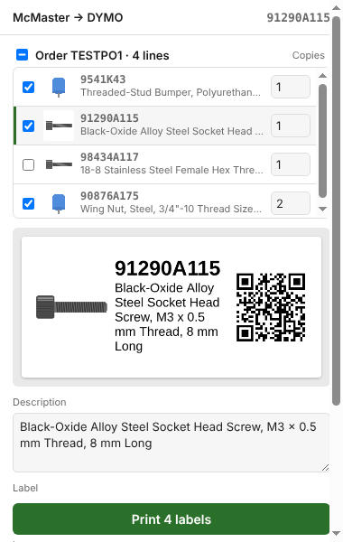

# McMaster → DYMO Label

Prints **DYMO LabelWriter 550** labels for McMaster-Carr parts: part number,
description, part picture and a QR code linking back to
`https://www.mcmaster.com/<part number>/`. Two ways to use it:

- **Chrome extension** — on a single part page, or on an order in Order History
  to label everything in that order at once.
- **Shop print server** — a small service on the Mac next to the printer. Share
  a part from the **McMaster iPhone app** (or type a part number on its web
  page) and the label prints; Chrome doesn't need to be open.


## Install
1. `git clone https://github.com/davidnichols/mcmaster2dymo` (or build a zip with `npm run package`).
2. Open `chrome://extensions`, turn on **Developer mode**.
3. **Load unpacked** → select the `extension/` folder.
4. Pin the extension. After pulling changes, click reload on its card.

## Printer setup
The LabelWriter 550 needs **DYMO Connect for Desktop** running; the extension
prints through its local web service. The first time, open
https://127.0.0.1:41951/DYMO/DLS/Printing/StatusConnected in Chrome and accept
the certificate (it should say `true`). Then the popup lists your DYMO printers.

Without DYMO Connect the extension falls back to Chrome's print dialog: pick
the LabelWriter, set the paper size to your label and Margins to None.

## Use
**One part:** on a part page (e.g. `mcmaster.com/9541K43`), click the icon or
press **Alt+Shift+L**. Check the preview, edit the description if needed,
choose label size, layout and printer, and click **Print label**.

**A whole order:** open the order in Order History
(`mcmaster.com/order-history/order/…`) and click the icon. Every line is
listed with a checkbox and a copies box (1 each by default). Untick lines you
don't want, set copies, click a line to preview it or edit its description,
then **Print N labels**. Each label is sent to the 550 in turn.



Settings (size, layout, printer, picture on/off) are remembered. If the shop
print server (below) is running on the same Mac, label size, layout and
picture on/off are shared with it: the popup picks up whatever is chosen on
the server page, and changes made in the popup are sent back.

## Shop print server (share from the iPhone app)
Runs on the Mac that has DYMO Connect and the LabelWriter. It listens on the
shop Wi-Fi; the iPhone Shortcut sends it a McMaster link, it reads the part
page with a headless Chrome (no login needed), renders the same label as the
extension and prints it. Nothing has to be open on the Mac.

```sh
npm install                 # once; canvas + playwright-core
npm run server              # try it: http://<your-mac>.local:41952/
npm run server:install      # install as a launchd agent (starts at login, auto-restarts)
npm run server:uninstall
```
Google Chrome (or Chromium) must be installed on the Mac; it's driven headless
and closed again after 5 minutes without jobs.

Open `http://<your-mac>.local:41952/` from any browser on the Wi-Fi: it shows
the printer, a preview of every label template (click one to make it the
template for all labels; label size and picture on/off are there too), a box
to print a part number or link, and the last labels printed. **`/shortcut`** on that page walks through building the iPhone
Shortcut (a share-sheet shortcut that POSTs to `/print`), with the right URL
filled in. Once it's built: open a part in the McMaster app → **Share** →
**Print McMaster label**. A notification reports *Printed 9541K43 ✓* or the
reason it didn't.

Settings live in `~/.mcmaster2dymo.json` (created on first run): `port`,
`printer` (blank = first connected 550), `size`, `layout`, `showImage`
(the three the web page edits), `copies`, `token` (optional shared secret the
Shortcut must send), `printWithoutDetails` (if McMaster can't be read, still
print the number and QR). Restart the server after editing the file by hand
(`npm run server:install` again does).

### Menu bar app (macOS 14+)
Instead of the launchd agent, run the server from a menu bar icon that also
lets you change what gets printed:
```sh
npm run app                  # builds dist/McMaster2DYMO.app (needs Xcode / Swift)
open dist/McMaster2DYMO.app
```
The tag icon's menu shows whether the server and the DYMO printer are up and
the last job, and lets you pick the **label size** and **layout**, toggle the
picture, start/stop/restart the server, open the status page or log, and turn
on **Launch at login**. **Settings…** covers the rest (printer, copies, port,
network/local-only, token, Chrome path). Every change is written to
`~/.mcmaster2dymo.json` and the server is restarted, so the iPhone Shortcut
prints the new style on its next share. If `npm run server:install` was used
before, the menu offers to remove that agent (both would fight over the port).

The app runs `node server/index.js` out of this checkout; the checkout path
and the `node` found at build time are baked into the app, so rebuild after
moving the repo or changing Node (or set the Node binary in Settings).

The HTTP API, for anything else that wants to print:
`POST /print` with JSON `{ "text": "<link or part numbers>", "copies": 2 }`,
a form field `text`, or a plain-text body; or `GET /print?pn=9541K43&copies=2`.
Response: `{ ok, message, labels: [{ partNumber, description, copies, ok, error? }] }`.

- **Label sizes:** 30336 (1" × 2-1/8", default), 30252 Address, 30256 Shipping.
- **Layouts:** Classic, Banner, Black bar, Big picture, QR first, Text only.
- **Pictures:** 300 px versions of McMaster's images. On a part page it uses
  the product render at the top of the page and skips dimension drawings; use
  ◀ ▶ under **Picture** to pick another, or untick it.

## Development
```sh
npm install          # canvas, playwright-core (server + tests), jsqr (tests)
npm test             # layout/QR tests, extractor tests, print-server tests, and end-to-end
                     # popup tests (extension loaded in headless Chromium, fake McMaster + DYMO)
npm run layouts      # regenerate docs/30336-layouts.png (or: npm run layouts -- 30252)
npm run package      # dist/mcmaster2dymo-<version>.zip
npm run app          # dist/McMaster2DYMO.app, the menu bar app (mac/, Swift)
```
The browser tests need Chrome or Chromium. The popup e2e test needs a
**Chromium** build, not branded Google Chrome: Chrome 137+ silently ignores
`--load-extension`, so the test fails with "extension not loaded". The
extractor and print-server tests run on either. The easiest fix is
Playwright's own Chromium, which `playwright-core` (already a dependency) can
download without installing the full `playwright` package:
```sh
npx playwright-core install chromium   # ~/Library/Caches/ms-playwright on macOS
```
`test/helpers.js` finds it there automatically (newest build first), before
any Chrome for Testing / Chromium in `/Applications`, before branded Chrome.
Set `CHROME_PATH` to override. Set `E2E_SCREENSHOTS=<dir>` to save popup
screenshots.

QR codes: [qrcode-generator](https://github.com/kazuhikoarase/qrcode-generator)
by Kazuhiko Arase (MIT), vendored at `extension/lib/qrcode.js`.

## License

[MIT](LICENSE) © 2026 David Nichols
