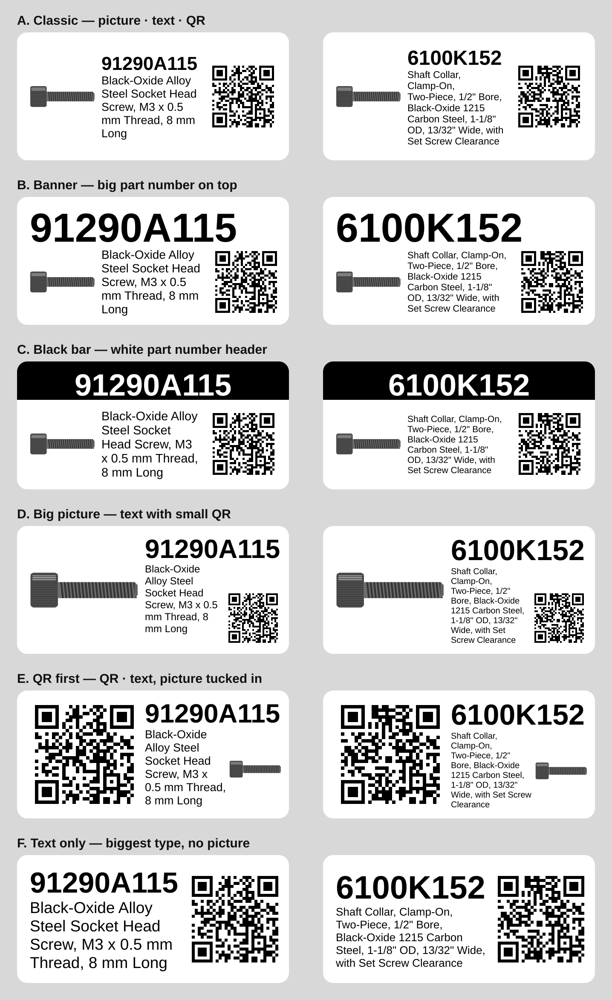

# McMaster → DYMO Label

Chrome extension that prints a **DYMO LabelWriter 550** label for the
McMaster-Carr part you're viewing: part number, description, part picture and
a QR code linking back to `https://www.mcmaster.com/<part number>/`.



## Install
1. `git clone https://github.com/davidnichols/mcmaster2dymo` (or build a zip with `npm run package`).
2. Open `chrome://extensions`, turn on **Developer mode**.
3. **Load unpacked** → select the `extension/` folder.
4. Pin the extension. After pulling changes, click reload on its card.

## Printer setup
The LabelWriter 550 needs **DYMO Connect for Desktop** running; the extension
prints through its local web service. The first time, open
https://127.0.0.1:41951/DYMO/DLS/Printing/StatusConnected in Chrome and accept
the certificate (it should say `true`). Then the popup lists your DYMO printers.

Without DYMO Connect the extension falls back to Chrome's print dialog: pick
the LabelWriter, set the paper size to your label and Margins to None.

## Use
On a part page (e.g. `mcmaster.com/9541K43`), click the icon or press
**Alt+Shift+L**. Check the preview, edit the description if needed, choose
label size, layout and printer, and click **Print label**. Settings are
remembered.

- **Label sizes:** 30336 (1" × 2-1/8", default), 30252 Address, 30256 Shipping.
- **Layouts:** Classic, Banner, Black bar, Big picture, QR first, Text only.
- **Picture:** the product render at the top of the page; dimension drawings
  are skipped. Use ◀ ▶ under **Picture** to pick another, or untick it.

## Development
```sh
npm install          # canvas, jsqr, playwright-core (dev only)
npm test             # layout/QR tests + page-extractor test in headless Chrome
npm run layouts      # regenerate docs/30336-layouts.png (or: npm run layouts -- 30252)
npm run package      # dist/mcmaster2dymo-<version>.zip
```
The extractor test needs Chrome or Chromium; set `CHROME_PATH` if it isn't
found automatically.

QR codes: [qrcode-generator](https://github.com/kazuhikoarase/qrcode-generator)
by Kazuhiko Arase (MIT), vendored at `extension/lib/qrcode.js`.
